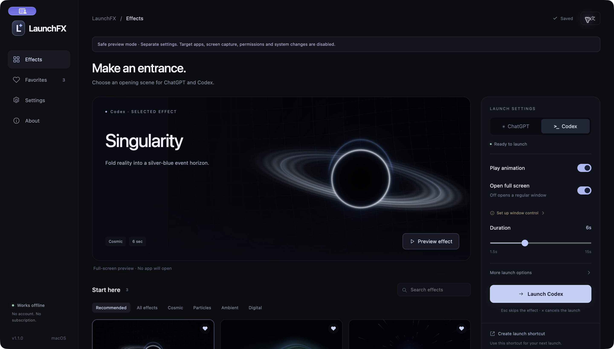

# LaunchFX

**Make an entrance.**

A cinematic opening scene for **ChatGPT and Codex** on macOS and Windows. Choose an effect, preview it, then launch your installed app. Keep a quiet aurora for ChatGPT and a desktop-bending black hole for Codex—or make both entirely your own.

[Download v1.1.1](https://github.com/xxdarktoxiccrowxx-tech/LaunchFX/releases/tag/v1.1.1) · [User guide](docs/USAGE.en.md) · [中文](README.md)



## A small studio for your first moment

- **12 original effects.** Singularity, Quantum Leap, Aurora, Warp Drive, Code Rain, Prism Portal, Eclipse, Nebula Bloom, Gravity Ripple, Orbital, Liquid Ink, and Constellation.
- **Two independent profiles.** Choose the effect, duration, shuffle, animation switch, and full-screen setting separately for ChatGPT and Codex. Codex defaults to full screen.
- **Preview before you launch.** Previews never open an app, capture your desktop, or play sound. Press Escape to close them.
- **A familiar daily shortcut.** Create a desktop launcher, use the menu bar or system tray, or enable global keyboard shortcuts.
- **Your desktop, transformed.** Optional desktop transitions bring your screen into the scene. Optional ambient audio is synthesized locally. Both are off by default.
- **Practical controls.** Favorites, search, 1.5–15 second duration, display selection, quality and frame-rate limits, reduced motion, automatic saving, and settings import/export.
- **English and Chinese.** New installations follow the system language: Chinese for Chinese locales, English otherwise. Your saved language choice is preserved.

LaunchFX runs offline, with no account, subscription, analytics, or cloud rendering. Effects are rendered with WebGL, with a Canvas 2D fallback. It does not patch or inject into OpenAI apps.

## Install

Download the appropriate package from [Releases](https://github.com/xxdarktoxiccrowxx-tech/LaunchFX/releases). ChatGPT or Codex must be installed separately.

| Platform | Package | Installation |
| --- | --- | --- |
| Apple silicon Mac, macOS 14+ | `mac-arm64.dmg` | Open the disk image and drag LaunchFX into Applications. |
| Intel Mac, macOS 14+ | `mac-x64.dmg` | Open the disk image and drag LaunchFX into Applications. |
| Windows 10/11, x64 | `.exe` installer | Run the installer and choose an installation folder. |
| Windows 10/11, x64 | `win-x64.zip` | Extract the entire archive, then open `LaunchFX.exe`. |

Install or move LaunchFX to its permanent location **before** creating app shortcuts.

**Signing and verification:** Current macOS packages are ad-hoc signed and not Apple-notarized; Windows packages are not publisher-signed. macOS Gatekeeper or Windows SmartScreen may show a warning. Download only from this repository's release page and check any published checksums. Do not disable system security globally. If you do not trust a package, build from the source instead.

This is an early public release. See the [verification record](docs/VERIFICATION.md) for exactly what was checked. Packaging and safe-preview checks do **not** establish that real ChatGPT/Codex handoff, permissions, or full-screen behavior has been verified on every platform. Target-app behavior also depends on the installed client version.

## Your first launch

1. Pick **ChatGPT** or **Codex** in the launch settings panel. If the app was not found, choose its installed location.
2. Select a recommended effect, or choose **Browse all 12 effects**. Click **Preview effect** to try it safely.
3. Set **Play animation**, **Open full screen**, and the duration. Click **Launch ChatGPT** or **Launch Codex** when ready.
4. Choose **Create launch shortcut** for everyday use. On macOS, drag the created launcher to the Dock. On Windows, use its desktop shortcut or pin it using the options your Windows version provides.

Effects play when you open apps **through LaunchFX or its shortcuts**. Clicking an original ChatGPT/Codex icon opens that app normally.

During a real launch, **Escape skips the effect and continues opening the app**; **× cancels before handoff**. Turning animations off still applies your full-screen or regular-window preference.

## Permissions and privacy

On macOS, Accessibility permission is needed to set the target app's window mode. Screen Recording permission is needed only if you enable desktop transitions. Previews require neither. You can configure these in **Settings → System permissions**.

A desktop transition obtains screen thumbnails, uses the selected screen as a temporary texture, and discards the images after the animation. Images are not saved or uploaded; no audio is captured. If capture is unavailable, the effect uses a synthetic scene. Windows full screen uses the selected app's borderless window and may be limited when the target app runs with higher privileges.

Read the [English user guide](docs/USAGE.en.md), [privacy details](docs/PRIVACY.md), and [verification record](docs/VERIFICATION.md) for behavior and limitations.

## Run from source

CI uses Node.js 24 and pnpm 11.25.0. macOS native builds also require Xcode Command Line Tools.

```sh
git clone https://github.com/xxdarktoxiccrowxx-tech/LaunchFX.git
cd LaunchFX
corepack enable
corepack prepare pnpm@11.25.0 --activate
pnpm install --frozen-lockfile
pnpm build:native
pnpm qa
```

`pnpm qa` opens a separate safe-preview environment. It blocks target-app launches, desktop capture, permission requests, login changes, and global shortcuts. Use `pnpm start` for normal operation.

```sh
pnpm check
pnpm test
pnpm dist:mac
# On a Windows build machine:
pnpm dist:win
```

See [build and release instructions](docs/BUILD.md) for native builds, signing, and CI. Report reproducible problems in [Issues](https://github.com/xxdarktoxiccrowxx-tech/LaunchFX/issues), including your OS version, LaunchFX version, target app, and the steps that failed. Do not include private desktop captures or chat content.

## License

[MIT](LICENSE). LaunchFX is an independent project, not affiliated with or sponsored by OpenAI. ChatGPT and Codex names belong to their respective owners.
