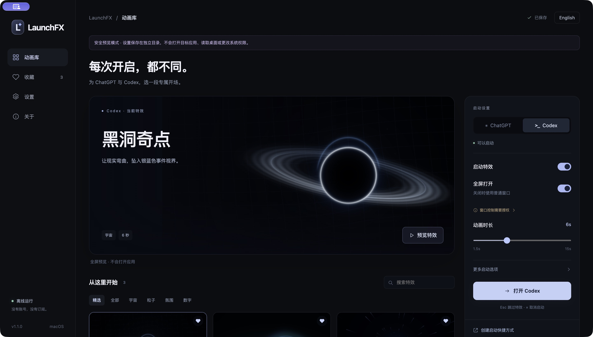

# LaunchFX

**给 ChatGPT 和 Codex 一个电影般的开场。**

LaunchFX 是 macOS / Windows 的独立启动特效工坊。选择动画、预览效果，再通过 LaunchFX 或专用快捷方式打开应用。动画结束后，目标应用按你的配置进入全屏或普通窗口。

[English](README.en.md) · [下载安装包](https://github.com/xxdarktoxiccrowxx-tech/LaunchFX/releases/tag/v1.1.1) · [安装与使用](docs/USAGE.zh.md) · [构建与发布](docs/BUILD.md) · [验证记录](docs/VERIFICATION.md)

## 下载

在 [GitHub Releases](https://github.com/xxdarktoxiccrowxx-tech/LaunchFX/releases) 下载：M 系列 Mac 选 `mac-arm64.dmg`，Intel Mac 选 `mac-x64.dmg`，Windows 10/11 x64 选 `win-x64.exe`。每个版本附有 SHA-256 校验文件；无需安装开发工具。

目前 Mac 安装包使用临时签名，尚未经过 Developer ID 公证；Windows 安装包尚未进行 Authenticode 签名。系统可能显示发行者验证提示。实际目标应用的启动与全屏联动仍需在你的安装版本上确认，完整实测范围见[验证记录](docs/VERIFICATION.md)。



## 12 种实时动画

| 动画 | 视觉 |
| --- | --- |
| 黑洞奇点 · Singularity | 吸积盘、引力透镜、桌面卷入黑洞 |
| 量子跃迁 · Quantum Leap | 粒子云与干涉场 |
| 极光轻幕 · Aurora | 柔和流动的极光 |
| 曲速穿梭 · Warp Drive | 向中心疾驰的星际光轨 |
| 代码之雨 · Code Rain | 发光的数字字符雨 |
| 棱镜之门 · Prism Portal | 多层旋转几何光门 |
| 日蚀之光 · Eclipse | 日冕与暗色天体 |
| 星云绽放 · Nebula Bloom | 流动星云与宇宙尘埃 |
| 引力涟漪 · Gravity Ripple | 扩散的空间波纹 |
| 星环轨道 · Orbital | 倾斜轨道与环绕粒子 |
| 流墨归一 · Liquid Ink | 液态光墨融合 |
| 群星汇聚 · Constellation | 星点、连线与中心汇聚 |

每种动画有独立着色器和 Canvas 2D 降级画面，不是同一段视频换颜色。所有素材与渲染均在本地。

1.1 版重做了视觉层次：更快出现清晰主体、减少背景粒子与纹理、保留一段平稳展示，再用一次明确的收束完成转场。动画库先展示三款精选，也可以浏览全部十二款。

## 功能

- **分别配置 ChatGPT / Codex**：特效开关、全屏开关、动画选择、1.5–15 秒时长。Codex 默认全屏。
- **预览与收藏**：实时展示、搜索、分类、收藏、从收藏中随机播放；无收藏时从全部动画随机。
- **画质与无障碍**：三档画质、30 / 60 / 120 FPS 上限、动态强度、主题光色、跟随系统减少动态效果。实际帧率取决于设备。
- **日常入口**：桌面快捷方式、菜单栏 / 托盘、可选全局快捷键、可选登录启动、应用运行时跳过动画。
- **沉浸转场**：可选本地合成音效与真实桌面吸入。默认关闭桌面读取和声音；预览始终不用真实桌面。
- **配置管理**：自动保存、导入 / 导出、恢复默认、异常配置备份、手动应用路径、显示器选择、中英文界面。
- **可取消**：Esc 跳过动画并继续启动；右上角 × 取消本次启动。预览中的 Esc 直接关闭预览。

## 使用

1. 将 macOS `.app` 放入 Applications，或运行 Windows 安装程序。
2. 在「应用与入口」确认 ChatGPT / Codex 路径，必要时手动选择。
3. 选择目标应用与动画，设置「启动后全屏」。
4. 点击「预览」检查画面，再用「启动」打开目标应用。
5. 创建专用快捷方式，将它放进 Dock / 开始菜单 / 任务栏，作为日常入口。

**特效通过 LaunchFX 入口触发。直接打开原来的 ChatGPT / Codex 图标不会经过 LaunchFX。** LaunchFX 不修改原应用，不注入进程，也不会替换系统文件。

macOS 全屏控制需要你在系统设置中允许 LaunchFX 的「辅助功能」权限。真实桌面转场另需「屏幕录制」权限。不开启桌面转场时不需要屏幕录制权限。Windows 使用目标窗口的无边框全屏。

## 开发

需要 Node.js 24、pnpm 11.25.0。macOS 原生助手另外需要 Xcode Command Line Tools。

```sh
corepack enable
corepack prepare pnpm@11.25.0 --activate
pnpm install --frozen-lockfile
pnpm build:native
pnpm qa
```

`pnpm qa` 使用隔离的临时设置，不会打开目标应用、读取桌面或注册系统入口。真实运行使用 `pnpm start`。

```sh
pnpm check
pnpm test
pnpm dist:mac
# 在 Windows 上：
pnpm dist:win
```

仓库包含 GitHub Actions，推送后在 macOS 与 Windows runner 上分别构建安装包。发布对应版本的 GitHub Release 后，工作流会构建并附加安装包与校验文件。发布前请阅读 [构建与发布](docs/BUILD.md)，配置自己的签名与公证。

## 支持范围

| 平台 | 构建目标 | 窗口模式 |
| --- | --- | --- |
| macOS 14+ | Apple Silicon / Intel | 原生 macOS 全屏或普通窗口 |
| Windows 10 / 11 | x64 | 无边框全屏；关闭时恢复窗口 |

当前实测范围与仍需验证的项目见 [验证记录](docs/VERIFICATION.md)。本项目是独立工具，与 OpenAI 没有隶属或赞助关系。ChatGPT / Codex 名称属于各自权利人；应用本身需要另行安装。

MIT License。项目代码、程序化动画与 LaunchFX 图标可随仓库发布。
